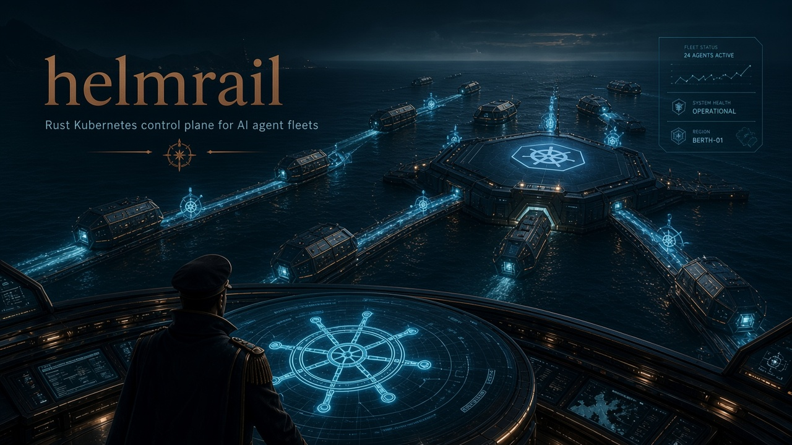

# Helmrail




**Helmrail — the rail that steers the fleet.**

Formerly **nauarchos**.

Rust Kubernetes control plane for deploying and directing a **fleet of agents** with declared dependencies, sandbox profiles, and on-demand workers.

| Sibling | Role |
|---------|------|
| [Coldberth](https://github.com/DataKnifeAI/coldberth) | Node/local Hermes + vLLM bootstrap |
| [Fleetshade](https://github.com/DataKnifeAI/fleetshade) | Fleet status board (observe) |
| **Helmrail** | Fleet deploy + direct (command) |

Helmrail does **not** replace [hermeum/hermes-agent-operator](https://github.com/hermeum/hermes-agent-operator). That operator provisions a single Hermes instance. Helmrail sits above (and beside) runtime operators: classes, fleets, tasks, sandboxes, and dependency bundles.

## Goals

- **Scale** — many agents as first-class cluster resources
- **Customization** — common options as typed CRD fields; escape hatch for advanced config
- **Self-hosting** — point at in-cluster or network vLLM / OpenAI-compatible APIs
- **Ease of use** — presets (`AgentClass`) + thin instances
- **Sandboxing** — NetworkPolicy, RuntimeClass, egress templates, optional nested terminal backends
- **Direction** — a director that spins **sub-agents on demand** for tasks

## Why Rust

Intentional learning vehicle for DataKnife: `kube-rs` controllers, typed CRDs, and a small async control plane.

Rust is a fit here (memory-safe long-lived controllers, solid `kube` ecosystem). Tradeoff vs Go is slower scaffolding and fewer operator tutorials — acceptable for this project. See [docs/PLAN.md](docs/PLAN.md).

## Status

**Design bootstrap** — architecture and CRD sketch checked in; operator reconcile loop not implemented yet.

## Quick map

```
GitOps / kubectl / API
         │
         ▼
   Helmrail operator (Rust / kube-rs)
         │
         ├── AgentClass      (presets: model, sandbox, deps)
         ├── Agent           (long-lived worker)
         ├── AgentFleet      (desired capacity / director)
         ├── AgentTask       (work unit → spawn/attach worker)
         └── DependencyBundle (sidecars, PVCs, secrets wiring)
         │
         ▼
   Runtime pods (Hermes, Cursor agents, custom images)
         │
         ▼
   Inference (Coldberth / cluster vLLM / external APIs)
```

## Docs

- [Architecture](docs/ARCHITECTURE.md)
- [Plan & milestones](docs/PLAN.md)
- [CRD sketch](docs/CRDS.md)

## Workspace layout

```
crates/
  helmrail-crd/       # CRD types (kube-derive)
  helmrail-operator/  # controller binary
docs/
```

## Develop

Requires Rust stable and a C linker (`gcc`/`clang`). CI uses `ubuntu-latest`.

```bash
make help    # targets
make build
make test
make lint
make ci      # fmt-check + clippy + test (local quality gate)
```

CI mirrors the operator siblings ([windrose-operator](https://github.com/DataKnifeAI/windrose-operator)): separate **Lint** and **Tests** workflows that call `make vet` / `make test`.

Review docs first: [PLAN.md](docs/PLAN.md) · [ARCHITECTURE.md](docs/ARCHITECTURE.md) · [CRDS.md](docs/CRDS.md)

## License

Apache License 2.0 · DataKnifeAI
